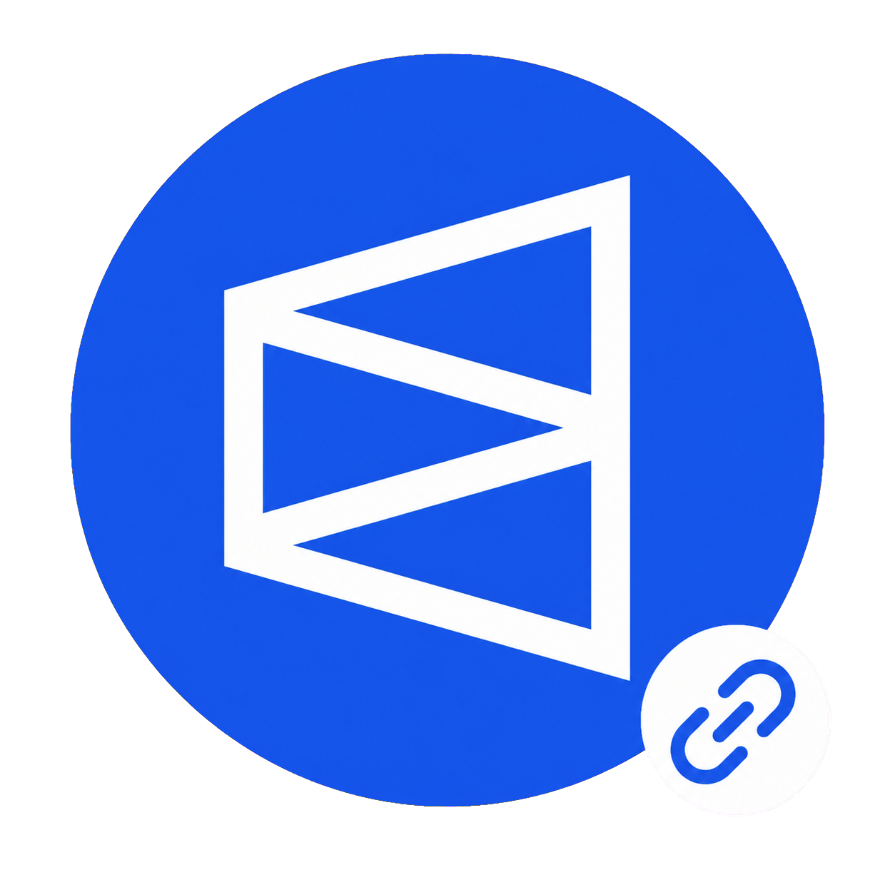

# Poly Dub

<p align="center">
  
</p>

Poly Dub creates and copies a tagged Dub link from a Polymarket DeFi or US page. Verified market pairs automatically route US visitors to the US app/web destination and other visitors to DeFi.

## Demo

https://github.com/user-attachments/assets/38a341bf-2963-4b27-a5fe-ed024de68544

## Install and connect

1. [Download the latest release ZIP](https://github.com/parkermclarenpoly/poly-dub/releases/latest/download/poly-dub.zip) and extract it.
2. Open `chrome://extensions`, enable **Developer mode**, select **Load unpacked**, and choose the extracted folder.
3. Ask a PolyLinks admin for a personal API key from [API access](https://dub-links-nine.vercel.app/admin/api). The key belongs to your existing PolyLinks user and inherits that user's account access.
4. In Poly Dub settings, enter the key, load your accounts, choose a default account, and save.
5. Pin Poly Dub to Chrome's toolbar.

Chrome 110 or newer is required. Existing users must reload the extension, approve the new PolyLinks host permission, and complete the new account setup. The old team password and free-form Dub tags do not authenticate this version.

## Use

Open an exact `polymarket.com` or `polymarket.us` page (including `www`) and click Poly Dub. For a verified match, it creates and copies one PolyLinks link with DeFi as the default and a verified US app/web override. PolyLinks assigns the selected account's tags, UTMs, ownership and conversion tracking.

Choose **Ask me which account each time** in settings to use the account picker. In default mode, other connected accounts are available from the extension's right-click menu. Account labels include the platform so identical handles remain distinct.

A missing cached match can take longer while PolyLinks checks the exact market. The extension preserves the page's market and outcome selectors and does not guess counterparts. If no US match is verified for a DeFi page, it asks you to **Create DeFi-only link**; nothing is copied before that choice. US sources require verified routing. A disabled service or failed lookup stops creation.

The extension saves request identities before sending them. If a request's outcome is uncertain, clicking again checks the same request instead of creating another link. A pending request may need a PolyLinks admin to reconcile it. Navigation or changing accounts does not discard an uncertain request. Never clear extension storage to retry an uncertain creation: the provider may already have created its link.

## Account access and privacy

The personal API key and account preferences stay in local Chrome extension storage. The key is sent only to `https://dub-links-nine.vercel.app/api/v1/`; it is never sent to a Polymarket page or content script. The server rechecks current account access, key status and quota on every request. Revoked keys need reconnection; changed account access needs a refresh in settings.

No Dub workspace credential, PolyLedger integration credential, team password or server signing key is included in the extension. See [PRIVACY.md](PRIVACY.md) for stored request and page data.

## Permissions

- `activeTab` and `scripting`: read the selected Polymarket page and show the result or consent prompt after an extension action.
- `clipboardWrite`: copy the resulting link.
- `storage`: save the personal API key, account preferences and request identities locally.
- `contextMenus`: choose an alternate account from the toolbar menu.
- `dub-links-nine.vercel.app`: authenticate account discovery and link creation with PolyLinks.
- Exact `polymarket.com` and `polymarket.us` hosts, including `www`: interact with supported pages.

## API and release contract

Version 1.6 uses the existing PolyLinks application at `https://dub-links-nine.vercel.app`. Setup calls `GET /api/v1/accounts`. Creation calls `POST /api/v1/links` with bearer authentication, a durable `Idempotency-Key`, and `{account_id, destination, require_routing:true}`. Explicit DeFi consent adds `allow_defi_only:true` and uses a new request identity.

Creation opts into `X-PolyLinks-Stream: 1`. The server sends headers and whitespace immediately; the final JSON includes the logical `status` and the standard API result. A scoped Chrome API keepalive covers slow matching. The server owns routing, authorization, tags, UTMs, preview behavior, quotas and attribution. The legacy standalone server source in `api/` supports older installations and is not deployed for this release.

Deploy the additive PolyLinks API changes before publishing the extension. Existing API consumers keep their usual behavior unless they opt into mandatory routing or streaming. No database migration, account permission change or shared-secret rotation is required.

## Development

With Node.js 20 or newer:

```sh
npm test
npm run package:extension -- release/poly-dub.zip
```

Tests use fixtures and do not create production links. The release ZIP contains extension files and documentation; server source, tests, environment files and personal credentials are excluded.
